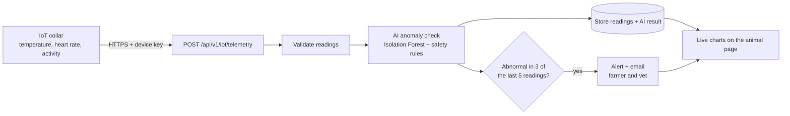

# AI-Based Livestock Health Monitoring System

A web app for farmers, veterinarians and admins (SE 231 project). Farmers log animal health data, an AI model estimates disease risk, and an automation engine creates alerts and reminders. Vets review cases and record treatment. English and Bangla.

> The AI gives a **risk estimate to support a vet. It is not a diagnosis.**

## 1. What you need installed
- **Python 3.11 or newer** (python.org). On Windows tick **"Add Python to PATH"**.
- **Node.js 18 or newer** (nodejs.org).
- Check in a terminal: `python --version` and `node --version`.

## 2. Run it on Windows (easiest)
1. Extract the zip. Open the folder `livestock-health`.
2. Double-click **`setup.bat`**. Wait until it says "Setup complete" (3 to 6 minutes the first time).
3. Double-click **`start.bat`**. Two black windows open and the browser opens `http://127.0.0.1:5173`.
4. Log in with a demo account (below).
5. To stop: close the two black windows. To run again later: only `start.bat`.

## 3. Run it step by step (any system)
**Backend** (terminal 1):
```
cd backend
python -m venv venv
venv\Scripts\activate          (macOS/Linux: source venv/bin/activate)
pip install -r requirements.txt
copy .env.example .env         (macOS/Linux: cp .env.example .env)
python -m app.ml.train         (trains the AI model, about 1 minute)
python scripts/seed.py         (creates demo data)
uvicorn app.main:app --reload --port 8000
```
**Frontend** (terminal 2):
```
cd frontend
npm install
npm run dev
```
Open **http://127.0.0.1:5173**. API docs (try every endpoint): **http://localhost:8000/docs**.

## 4. Demo accounts (password for all: `Password123!`)
| Role | Email | What to try |
| --- | --- | --- |
| Farmer | farmer@demo.com | Dashboard, animals, add a health record, import CSV, alerts, reports |
| Veterinarian | vet@demo.com | Case queue, confirm or reject AI predictions, record treatment |
| Admin | admin@demo.com | Approve vets, edit thresholds, view AI model metrics, run jobs |

Demo data: 12 animals with 30 days of records and 5 IoT collars with 24 hours of sensor data. **C-002, G-001, C-004** are developing illnesses, so alerts, AI results and charts have real content.

## 5. Five-minute demo script
1. Log in as **farmer**. Show the dashboard (charts, alerts, coverage).
2. Open animal **C-001** (healthy) -> **Add health record**: temperature 40.8, symptoms *Mouth lesions*, *Lameness*, *Loss of appetite*. Save: see **High risk**, top diseases with confidence, main factors, and the created alerts.
3. Open **Alerts**: acknowledge one, snooze another. Click the bell badge.
4. **Import CSV**: upload `data/sample_health_data.csv`. It has 2 deliberate bad rows; show the error report.
5. Switch language to **বাংলা** (top right). Everything changes, including alert messages.
6. Log out, log in as **vet**: open **Case queue** -> an animal -> confirm or reject the AI prediction -> **Vet consultations** tab -> save a diagnosis with a follow-up date.
7. Log back in as farmer: see the consultation, add a comment, download the **Animal health card (PDF)** and a **Herd report**.
8. Log in as **admin**: **Thresholds** (change cattle max temperature and see alerts change), **AI model** (metrics and synthetic-data notice), **Jobs** (run `reminders_daily`).

## 6. Folder map
```
backend/app/
  main.py            app start-up, error format, scheduler start
  models.py          all database tables
  routers/           API endpoints (auth, farms, animals, records, alerts, vet, dashboard, admin)
  services/pipeline.py   THE core flow: validate -> derive -> rules -> AI -> risk -> alerts -> status -> email
  services/          messages (EN/BN), email, reminders, reports, lookups
  ml/                generate_data.py, train.py, predict.py, features.py
  scheduler/jobs.py  daily and periodic jobs
backend/scripts/seed.py   demo data
backend/scripts/iot_simulator.py   pretend IoT collars (section 7b)
iot/esp32_collar/         example ESP32 firmware
backend/tests/            33 automated tests
frontend/src/pages/       one file per screen
frontend/src/i18n/        en.json and bn.json (all text)
docs/SPEC.md              the full requirements and design
Dockerfile, render.yaml   one-container deployment (section 12)
```

## 7. How the AI works (for your viva)
1. A **synthetic data generator** creates 6000 labeled cases from disease profiles (temperature, symptoms, feed and weight change).
2. `train.py` compares **Logistic Regression, Random Forest, Gradient Boosting** with 5-fold cross-validation and **macro F1**, picks the best, and **calibrates** probabilities so the confidence score is meaningful.
3. When a record is saved, `predict.py` returns the top 3 diseases with probabilities. Diseases impossible for the species or sex are removed (for example LSD in goats, mastitis in males).
4. **Explanation:** each active factor (a symptom, high temperature, lower feed) is switched off one at a time; the biggest drops in probability are shown as the "main factors".
5. **Risk level:** Low / Medium / High from cut-offs in the thresholds table. A **safety rule** forces High when there is a high fever plus 2 or more key symptoms, even if the model disagrees.
6. Vets can confirm or reject results. `python -m app.ml.export_feedback` exports confirmed cases for future retraining.

## 7b. IoT Sensor Monitoring (continuous data + AI anomaly detection)

Smart collars (or any IoT sensor) can send an animal's **body temperature, heart rate and activity** to the system continuously. An AI model checks every reading and **raises an alert automatically** when something looks abnormal, so a sick animal can be found before the farmer notices.

### How it works



1. **Register a device** (page *IoT devices*) and assign it to one animal. The system shows a secret **device key once**.
2. **The device sends readings** (one or many per request) with the header `X-Device-Key`.
3. **The AI checks each reading** against normal behaviour for that species, time of day, and the animal's own recent baseline.
4. **A persistence rule** raises an alert only if the problem continues (3 of the last 5 readings, or 2 of 3 for critical vitals), so one noisy reading never causes a false alarm.
5. **Alert and email** go to the farmer (and to approved vets if severity is high). The alert explains *why*, for example "high temperature, high heart rate", in English and Bangla.
6. The animal moves to *Under observation*, and the live chart marks the flagged readings with red dots.

### Sending data (API)

```bash
curl -X POST http://127.0.0.1:8000/api/v1/iot/telemetry \
  -H "Content-Type: application/json" \
  -H "X-Device-Key: <your device key>" \
  -d '{"temperature_c": 38.7, "heart_rate_bpm": 66, "activity_index": 42, "battery_pct": 91}'
```

Batch upload (up to 200 readings, useful when a device was offline):

```json
{ "readings": [
  { "recorded_at": "2026-11-24T08:00:00Z", "temperature_c": 38.6, "heart_rate_bpm": 65 },
  { "recorded_at": "2026-11-24T08:10:00Z", "temperature_c": 38.7 }
] }
```

| Field | Required | Valid range |
| --- | --- | --- |
| `temperature_c` | optional | 25 to 45 |
| `heart_rate_bpm` | optional | 15 to 260 |
| `activity_index` | optional | 0 to 100 |
| `battery_pct` | optional | 0 to 100 |
| `recorded_at` | optional (server time if missing) | not in the future, not older than 7 days |

At least one measurement is needed. **A temperature-only device works**: missing signals are simply not judged. Invalid readings are rejected one by one and listed in the response (`rejected`), and the rest are accepted.

Response: `{"accepted": 1, "rejected": [], "anomalies": 0, "alert_id": null, "analyzed": true}`

### Device and data endpoints

| Method and path | Who | Purpose |
| --- | --- | --- |
| `POST /api/v1/iot/telemetry` | device (key) | Send one or many readings |
| `POST /api/v1/iot/devices` | farmer | Register a device (returns the key once) |
| `GET /api/v1/iot/devices` | farmer, vet, admin | List devices with status (online, offline, never seen, unassigned) |
| `PATCH /api/v1/iot/devices/{id}` | farmer | Rename, assign or unassign an animal, activate or deactivate |
| `POST /api/v1/iot/devices/{id}/rotate-key` | farmer | Replace a lost or leaked key |
| `GET /api/v1/iot/animals/{id}/readings?hours=24` | all (own access) | Chart data with anomaly flags |
| `GET /api/v1/iot/summary` | all (own access) | Device counts, anomalies in 24 hours |

### The anomaly AI

- **Model:** Isolation Forest (unsupervised). It is trained **only on normal behaviour**, so it can flag problems it has never seen.
- **Features:** temperature and heart-rate deviation from what is normal for the species **at that hour**, activity deviation from the daily rhythm, and deviation from the **animal's own** recent baseline (median of its last normal readings).
- **Safety rules on top of the model:** critical vitals (temperature of 41.0 °C or more or 36.5 °C or less, heart rate of 130 bpm or more or 30 bpm or less) and clearly abnormal single signals are flagged even if the model is unsure.
- **Persistence:** alert only when abnormal readings continue (3 of the last 5).
- **Explanation:** every alert lists the abnormal signals (high or low temperature, heart rate, activity).
- **Other automatic alerts:** `device_offline` (no data for 30 minutes, configurable) and `device_low_battery` (15 percent or less). Old readings are deleted after 14 days.

Evaluation on **simulated** data (120 animals, 7 days each, injected fever, hypothermia, fast heart rate, lethargy and combined illness episodes), from `python -m app.ml.train`:

| Metric | Result |
| --- | --- |
| Problem episodes that raised an alert | about 91 percent |
| False alerts per animal per week | about 0.13 |
| Weakest case | Low activity at night (looks like normal sleep), so lethargy is mainly caught in the daytime |

> **Honest note:** the model is trained on simulated normal behaviour, and the species baselines (heart rate, temperature) are approximate placeholders. These numbers show that the pipeline works. They are **not** real-world accuracy. Collect real readings from healthy animals and retrain, and confirm baselines with a veterinarian, before relying on it.

### Try it without hardware (simulator)

With the backend running, in a second terminal inside `backend`:

```bash
python scripts/iot_simulator.py                 # 3 healthy demo collars, a reading every 3 seconds
python scripts/iot_simulator.py --sick C-001    # C-001 gets a fever after 8 readings: watch the alert appear
python scripts/iot_simulator.py --device-key dev_xxx --species cattle   # simulate YOUR registered device
```

Open an animal (for example **C-001**) and click the **Live sensors** tab to watch the chart update every 10 seconds. The demo data already contains five collars; **C-002** and **G-001** have a fever episode in the last two hours, so alerts exist from the start.

### Real hardware (example)

`iot/esp32_collar/esp32_collar.ino` is an example for an **ESP32** with a **DS18B20** waterproof temperature probe. It sends temperature and battery level every minute over WiFi. Heart rate and activity are optional: add a pulse sensor or an accelerometer and include `heart_rate_bpm` and `activity_index` in the JSON. The sketch has not been tested on real hardware; check wiring, waterproofing and values before use on an animal.

### Settings (Admin, *Thresholds* tab)

`iot_offline_minutes` (30), `iot_low_battery_pct` (15), `iot_retention_days` (14). Background jobs `iot_offline_check` and `iot_cleanup_daily` can be run manually from the *Jobs* tab.

### Security notes

- Each device has its **own key**, stored only as a hash. Rotate it if it leaks (*New key* button).
- A device can only write readings for the animal it is assigned to. It cannot read any data.
- Use HTTPS in production. There is no rate limiting yet.
- The demo keys (`demo-device-key-<TAG>`) are public. Do not use them outside demos.

### Limitations and future work

- HTTP only. MQTT or LoRaWAN gateways would suit farms with poor WiFi coverage.
- One active device per animal. Baselines are per species plus a rolling per-animal median.
- Retraining on real farm data, and using the sensor trends as inputs to the disease-risk model, are the next steps.

## 8. Run the tests
```
cd backend
venv\Scripts\activate
python -m pytest -q tests
```

## 9. Optional: real emails
Open `backend/.env`, fill `SMTP_HOST`, `SMTP_PORT`, `SMTP_USER`, `SMTP_PASSWORD`, `SMTP_FROM`, restart the backend. Until then emails are only logged.

## 10. Troubleshooting
**Login or Register does not work? Do this check first (30 seconds):**
1. Open **http://127.0.0.1:8000/health** in the browser. It must show `{"status":"ok"}`.
2. If the page does not open: the backend is not running. Look at the black "Backend API" window. If it shows a red error, send me that text. If there is no such window, run `start.bat` again.
3. If it shows ok but the website still fails: open **http://127.0.0.1:8000/docs**, try `POST /api/v1/auth/login` with `farmer@demo.com` / `Password123!`. If that works, close the Frontend window and run `start.bat` again (it picks up the latest settings).
4. Use the address **http://127.0.0.1:5173** (not a file opened from disk, and not another port).
5. If "Wrong email or password" appears for a demo account, the demo data is missing: stop the backend, delete `backend\livestock.db`, run `python scripts\seed.py` inside `backend` (with the venv active), start again.
6. Registration needs a password of 8 to 64 characters.

| Problem | Fix |
| --- | --- |
| `python` or `node` not recognized | Reinstall and tick "Add to PATH", then open a new terminal |
| Website shows "Network Error" or login fails | The backend window is not running. Run `start.bat` or the `uvicorn` command |
| "AI model is not trained" | Run `python -m app.ml.train` inside `backend` |
| Port already in use | Close old black windows, or use `--port 8001` and change the proxy in `frontend/vite.config.js` |
| Want a fresh demo database | Stop the backend, delete `backend/livestock.db`, run `python scripts/seed.py` |
| `pip install` is slow | scikit-learn and pandas are large; wait, or check your internet |

## 12. Publish the website online (free demo)
You can put the whole site (website + API + AI) on the internet as **one container**. The steps below use GitHub and Render, because Render's free plan needs no code changes. Always check Render's current free-plan rules before you rely on it.

**A. Put the project on GitHub**
1. Create a free account at github.com and click **New repository** (name: `livestock-health`, keep it empty).
2. In the project folder, open a terminal and run:
   ```
   git init
   git add .
   git commit -m "Livestock health monitoring system"
   git branch -M main
   git remote add origin https://github.com/YOUR-USERNAME/livestock-health.git
   git push -u origin main
   ```
   (`.gitignore` already skips passwords, databases and big folders.)

**B. Deploy on Render**
1. Sign up at render.com with your GitHub account.
2. Click **New** -> **Blueprint**, pick your `livestock-health` repository. Render reads `render.yaml` and creates the service. (Or: **New** -> **Web Service** -> your repo -> Runtime **Docker** -> Instance type **Free**; add environment variables `SECRET_KEY` = any long random text and `SEED_DEMO` = `true`.)
3. Wait 5 to 10 minutes for the first build (it builds the website and trains the AI).
4. Open the address Render shows, like `https://livestock-health.onrender.com`. Log in with the demo accounts.

**What to expect on the free plan**
- The site **sleeps after 15 minutes without visitors**. The first visit afterwards can take up to a minute to wake up.
- Free services **forget files on restart or sleep**, including the SQLite database. That is why `SEED_DEMO=true` re-creates the demo data (about 20 to 30 seconds after waking). Anything users add online is lost.
- **Anyone with the link can log in** with the demo accounts. Do not enter real farm data. For a real deployment: set `SEED_DEMO` to `false`, create your own admin, and use a paid persistent disk or a PostgreSQL database (add `psycopg2-binary` to `requirements.txt` and set `DATABASE_URL`). Free Render databases expire after 30 days.
- Emails are still only logged unless you add `SMTP_*` variables.

**Other ways to share it**
- Show it from your own PC with `start.bat` (best for a viva: no internet needed).
- Record a screen video of the demo script (section 5).
- Share the GitHub link so your teacher can read the code and run it.

## 11. Limits (be honest in the report)
See **ASSUMPTIONS.md**: synthetic training data, approximate medical values, English-only PDFs, items from the spec that were not built.
