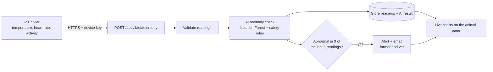

## IoT Sensor Monitoring (continuous data + AI anomaly detection)

Smart collars (or any IoT sensor) can send an animal's **body temperature, heart rate and activity** to the system continuously. An AI model checks every reading and **raises an alert automatically** when something looks abnormal, so a sick animal can be found before the farmer notices.

### How it works



1. **Register a device** (page *IoT devices*) and assign it to one animal. The system shows a secret **device key once**.
2. **The device sends readings** (one or many per request) with the header `X-Device-Key`.
3. **The AI checks each reading** against normal behaviour for that species, time of day, and the animal's own recent baseline.
4. **A persistence rule** raises an alert only if the problem continues (3 of the last 5 readings, or 2 of 3 for critical vitals), so one noisy reading never causes a false alarm.
5. **Alert and email** go to the farmer (and to approved vets if severity is high). The alert explains *why*, for example "high temperature, high heart rate", in English and Bangla.
6. The animal moves to *Under observation*, and the live chart marks the flagged readings with red dots.

### Sending data (API)

```bash
curl -X POST http://127.0.0.1:8000/api/v1/iot/telemetry \
  -H "Content-Type: application/json" \
  -H "X-Device-Key: <your device key>" \
  -d '{"temperature_c": 38.7, "heart_rate_bpm": 66, "activity_index": 42, "battery_pct": 91}'
```

Batch upload (up to 200 readings, useful when a device was offline):

```json
{ "readings": [
  { "recorded_at": "2026-11-24T08:00:00Z", "temperature_c": 38.6, "heart_rate_bpm": 65 },
  { "recorded_at": "2026-11-24T08:10:00Z", "temperature_c": 38.7 }
] }
```

| Field | Required | Valid range |
| --- | --- | --- |
| `temperature_c` | optional | 25 to 45 |
| `heart_rate_bpm` | optional | 15 to 260 |
| `activity_index` | optional | 0 to 100 |
| `battery_pct` | optional | 0 to 100 |
| `recorded_at` | optional (server time if missing) | not in the future, not older than 7 days |

At least one measurement is needed. **A temperature-only device works**: missing signals are simply not judged. Invalid readings are rejected one by one and listed in the response (`rejected`), and the rest are accepted.

Response: `{"accepted": 1, "rejected": [], "anomalies": 0, "alert_id": null, "analyzed": true}`

### Device and data endpoints

| Method and path | Who | Purpose |
| --- | --- | --- |
| `POST /api/v1/iot/telemetry` | device (key) | Send one or many readings |
| `POST /api/v1/iot/devices` | farmer | Register a device (returns the key once) |
| `GET /api/v1/iot/devices` | farmer, vet, admin | List devices with status (online, offline, never seen, unassigned) |
| `PATCH /api/v1/iot/devices/{id}` | farmer | Rename, assign or unassign an animal, activate or deactivate |
| `POST /api/v1/iot/devices/{id}/rotate-key` | farmer | Replace a lost or leaked key |
| `GET /api/v1/iot/animals/{id}/readings?hours=24` | all (own access) | Chart data with anomaly flags |
| `GET /api/v1/iot/summary` | all (own access) | Device counts, anomalies in 24 hours |

### The anomaly AI

- **Model:** Isolation Forest (unsupervised). It is trained **only on normal behaviour**, so it can flag problems it has never seen.
- **Features:** temperature and heart-rate deviation from what is normal for the species **at that hour**, activity deviation from the daily rhythm, and deviation from the **animal's own** recent baseline (median of its last normal readings).
- **Safety rules on top of the model:** critical vitals (temperature of 41.0 °C or more or 36.5 °C or less, heart rate of 130 bpm or more or 30 bpm or less) and clearly abnormal single signals are flagged even if the model is unsure.
- **Persistence:** alert only when abnormal readings continue (3 of the last 5).
- **Explanation:** every alert lists the abnormal signals (high or low temperature, heart rate, activity).
- **Other automatic alerts:** `device_offline` (no data for 30 minutes, configurable) and `device_low_battery` (15 percent or less). Old readings are deleted after 14 days.

Evaluation on **simulated** data (120 animals, 7 days each, injected fever, hypothermia, fast heart rate, lethargy and combined illness episodes), from `python -m app.ml.train`:

| Metric | Result |
| --- | --- |
| Problem episodes that raised an alert | about 91 percent |
| False alerts per animal per week | about 0.13 |
| Weakest case | Low activity at night (looks like normal sleep), so lethargy is mainly caught in the daytime |

> **Honest note:** the model is trained on simulated normal behaviour, and the species baselines (heart rate, temperature) are approximate placeholders. These numbers show that the pipeline works. They are **not** real-world accuracy. Collect real readings from healthy animals and retrain, and confirm baselines with a veterinarian, before relying on it.

### Try it without hardware (simulator)

With the backend running, in a second terminal inside `backend`:

```bash
python scripts/iot_simulator.py                 # 3 healthy demo collars, a reading every 3 seconds
python scripts/iot_simulator.py --sick C-001    # C-001 gets a fever after 8 readings: watch the alert appear
python scripts/iot_simulator.py --device-key dev_xxx --species cattle   # simulate YOUR registered device
```

Open an animal (for example **C-001**) and click the **Live sensors** tab to watch the chart update every 10 seconds. The demo data already contains five collars; **C-002** and **G-001** have a fever episode in the last two hours, so alerts exist from the start.

### Real hardware (example)

`iot/esp32_collar/esp32_collar.ino` is an example for an **ESP32** with a **DS18B20** waterproof temperature probe. It sends temperature and battery level every minute over WiFi. Heart rate and activity are optional: add a pulse sensor or an accelerometer and include `heart_rate_bpm` and `activity_index` in the JSON. The sketch has not been tested on real hardware; check wiring, waterproofing and values before use on an animal.

### Settings (Admin, *Thresholds* tab)

`iot_offline_minutes` (30), `iot_low_battery_pct` (15), `iot_retention_days` (14). Background jobs `iot_offline_check` and `iot_cleanup_daily` can be run manually from the *Jobs* tab.

### Security notes

- Each device has its **own key**, stored only as a hash. Rotate it if it leaks (*New key* button).
- A device can only write readings for the animal it is assigned to. It cannot read any data.
- Use HTTPS in production. There is no rate limiting yet.
- The demo keys (`demo-device-key-<TAG>`) are public. Do not use them outside demos.

### Limitations and future work

- HTTP only. MQTT or LoRaWAN gateways would suit farms with poor WiFi coverage.
- One active device per animal. Baselines are per species plus a rolling per-animal median.
- Retraining on real farm data, and using the sensor trends as inputs to the disease-risk model, are the next steps.
